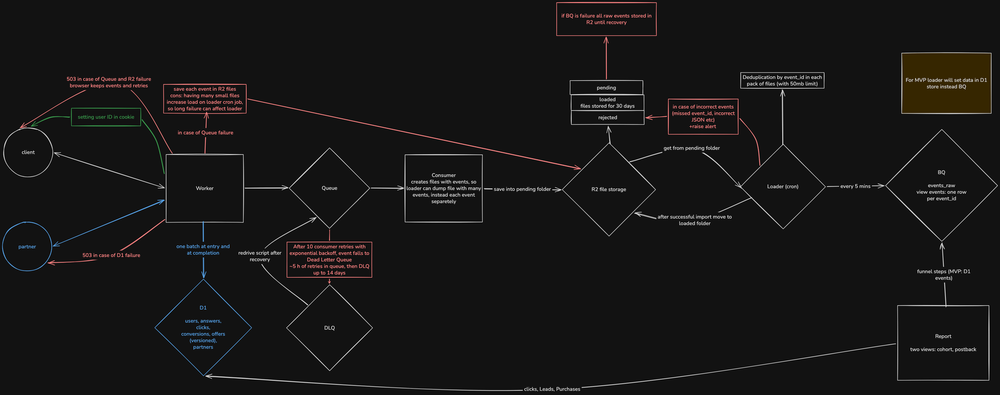

# Funnels analytics events system

[](https://github.com/arthurseredaa/argus-analytics-system/actions/workflows/ci.yml)

An MVP on Cloudflare Workers that collects funnel events. It is one Worker built with Hono, two D1 databases, a Queue and R2. The system design is in [docs/design/design.md](docs/design/design.md), and the implementation plan is in [docs/plans/part2-mvp-stages.md](docs/plans/part2-mvp-stages.md).

## Architecture in the code



The diagram has four paths:

- Live path: the browser calls the Worker, which reads and writes the facts in the D1 facts database in one batch and answers with a page, an offer or a redirect.
- Event path: the Worker sends each event to a Queue, a consumer writes each batch as a file to R2 `pending/`, and a loader cron loads the files into the D1 events database every minute. In production the loader would write to BigQuery instead.
- Postback path: a partner posts a signed Lead or Purchase to the Worker, which writes it to D1.
- Report path: the report reads clicks, Leads and Purchases from the D1 facts database and funnel steps from the D1 events database.

### Components and folders

Each file under `src/` opens with a comment that names its component, the ADR it implements and the requirement ids it serves. The table follows those comments.

| Component                                                                                                       | Folder                                    | ADR                                                                                                                                                                                                                                                                                |
| --------------------------------------------------------------------------------------------------------------- | ----------------------------------------- | ---------------------------------------------------------------------------------------------------------------------------------------------------------------------------------------------------------------------------------------------------------------------------------- |
| HTTP routes, one file per endpoint, and the identity cookie middleware                                          | `src/routes/`                             | each file names its own: [0002](docs/adr/0002-user-identity.md) identity, [0004](docs/adr/0004-offer-selection-semantics.md) selection moments, [0005](docs/adr/0005-event-ingestion-and-buffering.md) event intake, [0007](docs/adr/0007-postback-contract-and-auth.md) postbacks |
| Offer selection `select()`, the catalog, the quiz flow, postback signatures, click ids, email and secret crypto | `src/domain/`                             | [0004](docs/adr/0004-offer-selection-semantics.md) selection, [0007](docs/adr/0007-postback-contract-and-auth.md) signature and click ids, [0002](docs/adr/0002-user-identity.md) crypto; the quiz flow has no ADR (a reversible decision in the plan)                             |
| Raw SQL against D1, all of it                                                                                   | `src/db/`                                 | [0003](docs/adr/0003-operational-store.md) facts in D1; [0005](docs/adr/0005-event-ingestion-and-buffering.md) for the events table                                                                                                                                                |
| Event envelope, producer `sendEvent()`, Queue consumer, loader                                                  | `src/events/`                             | [0005](docs/adr/0005-event-ingestion-and-buffering.md), [0006](docs/adr/0006-bigquery-delivery.md)                                                                                                                                                                                 |
| Analytics Engine data points and the alert evaluator                                                            | `src/ops/`                                | [metrics-and-operations.md](docs/design/metrics-and-operations.md)                                                                                                                                                                                                                 |
| Server-rendered quiz, report and no-offer pages, the browser outbox                                             | `src/pages/`                              | quiz page: none (quiz flow decision); outbox: [0005](docs/adr/0005-event-ingestion-and-buffering.md); no-offer page: [0004](docs/adr/0004-offer-selection-semantics.md)                                                                                                            |
| Quiz flow config, one JSON per prelander                                                                        | `config/prelanders/`                      | none (quiz flow decision)                                                                                                                                                                                                                                                          |
| Numbered SQL migrations for the facts and the events database                                                   | `migrations/facts/`, `migrations/events/` | [0003](docs/adr/0003-operational-store.md), [0005](docs/adr/0005-event-ingestion-and-buffering.md)                                                                                                                                                                                 |
| Seed, offer, postback, sink, demo, email scan and docs lint scripts                                             | `scripts/`                                | each script names its own, for example `postback.ts` [0007](docs/adr/0007-postback-contract-and-auth.md), `offer.ts` [0003](docs/adr/0003-operational-store.md)                                                                                                                    |

`src/index.ts` exports the three entry points of the one Worker: `fetch` (the Hono app in `src/app.ts`), `queue` (the consumer) and `scheduled` (the loader every minute, the alert evaluator every 5 minutes).

### Request path of the demo

The five demo steps, DEMO-2 to DEMO-6, through the code. Every event below is sent through `sendEvent()` in `src/events/producer.ts`. It goes to the Queue, then the consumer (`consumeEvents()` in `src/events/consumer.ts`) writes it to R2 `pending/`, and the loader (`runLoader()` in `src/events/loader.ts`) writes it to the `events` table. Tables named below are in the facts database unless stated otherwise.

| Step   | Request                                  | Code                                                                                                                                                                                                                                         | Tables                                                                        | Events                                                                                                             |
| ------ | ---------------------------------------- | -------------------------------------------------------------------------------------------------------------------------------------------------------------------------------------------------------------------------------------------- | ----------------------------------------------------------------------------- | ------------------------------------------------------------------------------------------------------------------ |
| DEMO-2 | `GET /p/demo`, no cookie                 | `identity()` in `src/routes/identity.ts` sets the cookie; `prelanderRoute()` in `src/routes/prelander.ts` renders the quiz from `config/prelanders/demo.json`                                                                                | none: a new user touches no table                                             | `prelander_viewed` (`quiz`)                                                                                        |
| DEMO-2 | `POST /api/events`, once per step event  | `eventsRoute()` in `src/routes/events.ts` checks the envelope and answers `202`                                                                                                                                                              | none in the facts database                                                    | `step_viewed` 1 to 3, `step_answered` for gender and ethnicity                                                     |
| DEMO-2 | `POST /api/complete`                     | `completeRoute()` in `src/routes/complete.ts` encrypts the email (`src/domain/crypto.ts`), calls `completeQuiz()` in `src/db/facts.ts`, then `select(facts, catalog, "completion")` in `src/domain/select.ts`; answers offer 003, `best_epu` | writes `users`, `user_answers`; reads Leads and the catalog, all in one batch | `quiz_completed`, `offer_selected`                                                                                 |
| DEMO-2 | `GET /go?prelander=demo`                 | `goRoute()` in `src/routes/go.ts` calls `readFacts()` and `select(..., "redirect")`, then `startTransition()` in `src/routes/transition.ts` writes the click with `insertClick()` and answers `302`                                          | reads `users`, `user_answers`, Leads, catalog; writes `clicks`                | `offer_click`                                                                                                      |
| DEMO-3 | `POST /postback/v1/partnerA`, a Lead     | `handle()` in `src/routes/postback.ts`: `readPartner()`, the secret decrypted, `verifySignature()` in `src/domain/signature.ts`, `findClickForPostback()`, `insertConversion()`; answers `202`                                               | reads `partners`, `clicks`; writes `conversions`, `postback_counts`           | `lead`                                                                                                             |
| DEMO-4 | `GET /p/demo` with the cookie            | `prelanderRoute()` calls `readFacts()` and `select(..., "entry")`, which gives `lead_return`; `startTransition()` writes a new click and answers `302`, so the quiz is skipped                                                               | reads the user's facts; writes `clicks`                                       | `prelander_viewed` (`lead_return`), `offer_selected`, `offer_click`                                                |
| DEMO-5 | `POST /postback/v1/partnerA`, a Purchase | the same `handle()` as DEMO-3; answers `202`                                                                                                                                                                                                 | writes `conversions`, `postback_counts`                                       | `purchase`                                                                                                         |
| DEMO-6 | the Purchase and the Lead again          | `insertConversion()` meets the unique key on `(partner_id, type, transaction_id)` and writes nothing; answers `200 {"status":"duplicate"}`                                                                                                   | `postback_counts` only                                                        | the same event again with the same derived EventID; the loader's `ON CONFLICT (event_id) DO NOTHING` keeps one row |

The report the demo checks is `reportRoute()` in `src/routes/report.ts`, which reads both databases through `src/db/report.ts`. The full sequence diagram is in [request-flow.md](docs/design/request-flow.md), and the rows each step writes are in [data-model.md, Trace of the demo](docs/design/data-model.md#trace-of-the-demo).

### What to read first

For a reviewer with 30 minutes, in this order:

1. [design.md section 2](docs/design/design.md#2-architecture-and-alternatives): the diagram, the endpoints and the alternatives that were set aside.
2. [request-flow.md](docs/design/request-flow.md): the demo as a sequence of requests.
3. [ADR 0003](docs/adr/0003-operational-store.md): why the facts the rules read live in one D1 database and raw events stay out of it.
4. [ADR 0005](docs/adr/0005-event-ingestion-and-buffering.md): the event path through the Queue, R2 and the loader, and where an event waits during each outage.
5. [`src/domain/select.ts`](src/domain/select.ts): offer selection as one pure function, called at entry, completion and redirect.
6. [`src/events/loader.ts`](src/events/loader.ts): the loader, where every step can be repeated without counting an event twice.

## Demo

The Worker is deployed at <https://funnels-analytics-events.bblog.workers.dev> (DLV-1). There a reviewer can:

- take the quiz in a browser at `/p/demo`;
- open the funnel report at `/report`;
- call `GET /healthz`, which returns the commit sha the Worker was built from.

The steps that need a signed postback run locally. The partner secrets of the deployed Worker are only in its owner's `.dev.vars.remote` and not in the repository, so a reviewer runs the postbacks and the full demo against their own `wrangler dev` with their own `.dev.vars`. The browser test can still run against the deployed Worker (see [Tests and the gate](#tests-and-the-gate)).

## Install and run

You need Node 24 and pnpm 10.

```sh
pnpm install
```

Create `.dev.vars` from [.dev.vars.example](.dev.vars.example), with each key filled by `openssl rand -base64 32`. This writes the same keys the example lists:

```sh
cat > .dev.vars <<EOF
MASTER_KEY=$(openssl rand -base64 32)
EMAIL_HASH_KEY=$(openssl rand -base64 32)
PARTNER_SECRET_PARTNERA=$(openssl rand -base64 32)
PARTNER_SECRET_PARTNERB=$(openssl rand -base64 32)
TEST_ROUTES=on
GIT_SHA=dev
EOF
```

The example also lists two optional keys, `AE_SQL_TOKEN` and `CF_ACCOUNT_ID`. They let the alert run read the Analytics Engine SQL API. Without them the three SQL alerts (`selection_p95`, `worker_5xx_rate`, `d1_overload_errors`) log `alert_source_unavailable` and the other alerts still run. A local run does not need them.

Then create the local databases, seed the catalog and start the Worker:

```sh
pnpm migrate:local
pnpm seed --local
pnpm dev
```

In another terminal:

```sh
curl http://localhost:8787/healthz
```

It prints `{"sha":"dev"}`.

## Tests and the gate

```sh
pnpm check
```

`pnpm check` runs what the CI `check` job runs: typecheck, lint, format check, docs lint, state check and tests. `pnpm typecheck` generates `worker-configuration.d.ts` first, so it works on a fresh checkout.

`pnpm install` wires `pnpm check` as the git pre-commit hook. `git commit --no-verify` skips it and is not used in this repository.

Tests sit on three levels, and the level is the folder:

| Level       | Folder                             | What runs there                                                                                          |
| ----------- | ---------------------------------- | -------------------------------------------------------------------------------------------------------- |
| Unit        | `tests/unit/`                      | pure functions in plain Node, such as `select()`, the quiz flow, the signature and the report arithmetic |
| Integration | `tests/integration/`               | one request through the real Worker in the Workers runtime, with local D1, Queue and R2 bindings         |
| End to end  | `tests/e2e/` and `scripts/demo.sh` | the Playwright quiz test in Chromium, and the demo script driving a running Worker with curl             |

`pnpm test` runs the unit and integration tests. Every test name starts with its requirement id, so one requirement runs on its own:

```sh
pnpm test -t "OFF-5"
pnpm test -t "PB-3|PB-8"
```

`pnpm test -t "X"` filters by name. `pnpm test -- -t "X"` runs the whole suite.

The browser test needs Chromium, installed once, a free port 8787 and the `.dev.vars` from [Install and run](#install-and-run). Do that before seeding:

```sh
pnpm exec playwright install chromium
pnpm migrate:local
pnpm seed --local
pnpm test:browser
```

`pnpm test:browser` starts `wrangler dev` and drives the quiz in Chromium. The page's own JavaScript sends five events and the server adds three, eight in total. The test proves that the email reaches only the completion request. At the end it runs `pnpm test:email-scan` over the wrangler log and the local state, which prints `email-scan: clean` when the test address is in none of them. The scan runs only against local `wrangler dev`.

Against the deployed Worker, the same test runs with `BASE` set. It then prints `email-scan skipped` after the Playwright summary:

```sh
BASE=https://funnels-analytics-events.bblog.workers.dev pnpm test:browser
```

`pnpm test:email-scan` also runs on its own: `pnpm test:email-scan <wrangler-log>` for a local log and the local state, `pnpm test:email-scan --dir <dir>` for every file under a directory. A third mode, `--remote <tail-log> --since <ms>`, scans a `wrangler tail` capture and the deployed Worker's R2 files and events rows; it needs a wrangler login to the owner's account.

## Send a test postback

`pnpm postback` signs a Lead or a Purchase the way a partner would and sends it to the Worker:

```sh
pnpm postback lead|purchase --click <id> --txn <id> [--partner partnerA] [--payout 25.00] [--currency USD] [--base <url>]
```

The base is `--base`, then `BASE`, then `http://localhost:8787`. For a `localhost` base the script reads the partner's secret from `.dev.vars`. For any other base it reads `.dev.vars.remote`, which only the owner of the deployed Worker has, so reviewers send postbacks to their local Worker. The secret is never read from the shell environment, and the script never follows a redirect.

A postback needs a click id. With `pnpm dev` running, this makes a user, takes the quiz and presses the offer button with curl. The click id is in the `Location` header of the `302` from `/go`:

```sh
source scripts/acceptance.sh        # helpers; sets BASE=http://localhost:8787, TMP and JAR
curl -s -c $JAR -b $JAR -o /dev/null $BASE/p/demo
complete $JAR women asia user1@example.com
CLICK=$(curl -s -b $JAR -o /dev/null -w '%{redirect_url}' "$BASE/go?prelander=demo" | sed 's/.*click_id=//')
```

The same id is in `GET /__test/state` for that cookie: `curl -s -b $JAR $BASE/__test/state | jq -r '.me.clicks[-1].click_id'`.

Then:

```sh
pnpm -s postback lead --click $CLICK --txn T-1                                     # 202 {"status":"accepted"}
pnpm -s postback lead --click $CLICK --txn T-1                                     # 200 {"status":"duplicate"}
pnpm -s postback purchase --click $CLICK --txn T-2 --payout 25.00 --currency USD   # 202 {"status":"accepted"}
```

A transaction id counts once per partner and type, so a second run against the same store needs new `--txn` values, or its first answer is already `duplicate`. The answers mean:

| Answer                         | Meaning                                                                         |
| ------------------------------ | ------------------------------------------------------------------------------- |
| `202 {"status":"accepted"}`    | the Lead or Purchase is stored                                                  |
| `200 {"status":"duplicate"}`   | the same partner, type and transaction id was stored before; nothing changes    |
| `202 {"status":"quarantined"}` | the signature is valid but the click is unknown; the body waits in `quarantine` |
| `401 {"error":"unauthorized"}` | the signature or the timestamp failed, or the partner is unknown or inactive    |

A `401` on a fresh setup usually means `.dev.vars` changed after `pnpm seed --local`: the seed stores each partner's secret once and does not replace it (see [Known limitations](#known-limitations)). The contract is in [ADR 0007](docs/adr/0007-postback-contract-and-auth.md).

## Repeat the demo

`pnpm test:e2e` runs the demo scenario from [docs/testing/acceptance-checks.md](docs/testing/acceptance-checks.md) with every answer asserted. It resets the store, takes a user through the quiz to offer 003, sends a signed Lead, sends the user back, sends a signed Purchase and repeats both postbacks. It prints `ok <step>` for each passed check, the `diff` of the report before and after the Purchase, and `demo passed against <base>` at the end. On the first mismatch it prints `FAIL <step>: expected <x>, got <y>` and exits 1.

Locally:

```sh
pnpm migrate:local && pnpm seed --local   # once
pnpm test:e2e                             # starts its own wrangler dev on port 8787
```

Without `--base` and `BASE`, the script starts `wrangler dev` itself and needs port 8787 free. `wrangler dev` runs no cron, so the script adds a ticker that runs the loader every 10 seconds. A local run takes about 1.5 minutes.

On Cloudflare, for the owner of the deployed Worker only:

```sh
pnpm test:e2e --base https://funnels-analytics-events.bblog.workers.dev
```

A deployed run takes about 2 to 3 minutes. It resets that Worker's store and signs its postbacks with the secrets from `.dev.vars.remote`, which are not in the repository.

Both runs wait because the report counts events, and an event reaches D1 through the Queue batch (up to 30 seconds) and the loader's next run. Each wait covers both.

While the loader is paused (`pnpm sink outage on`, or `--remote` for the deployed Worker), the demo prints `loader paused: funnel cells are expected to stay 0`. It then expects the funnel cells (visits, started, steps, completed) to stay 0 and checks everything else as in a normal run. `pnpm sink outage off` resumes the loader.

## Expected results

Offer selection for the answers a reviewer is most likely to try. The full table, 29 rows, is in [docs/requirements/offer-selection.md](docs/requirements/offer-selection.md). Each row below is the row with the same number there, and all five are among the spec's own worked examples.

| Row | Answers        | Lead | Result                  | Reason               |
| --- | -------------- | ---- | ----------------------- | -------------------- |
| 1   | women + asia   | none | offer 003               | `best_epu`           |
| 3   | women + europe | none | offer 004               | `best_epu`           |
| 5   | women + latam  | none | offer 007               | `fallback_universal` |
| 6   | men + latam    | none | offer 006               | `best_epu`           |
| 16  | women + asia   | 001  | offer 001, quiz skipped | `lead_return`        |

The report after each step of the demo, from an empty store:

| After  | visits | started | step_1 | step_2 | step_3 | completed | went_to_offer | transitions | lead | purchase |
| ------ | ------ | ------- | ------ | ------ | ------ | --------- | ------------- | ----------- | ---- | -------- |
| reset  | 0      | 0       | 0      | 0      | 0      | 0         | 0             | 0           | 0    | 0        |
| DEMO-2 | 1      | 1       | 1      | 1      | 1      | 1         | 1             | 1           | 0    | 0        |
| DEMO-3 | 1      | 1       | 1      | 1      | 1      | 1         | 1             | 1           | 1    | 0        |
| DEMO-4 | 2      | 1       | 1      | 1      | 1      | 1         | 1             | 2           | 1    | 0        |
| DEMO-5 | 2      | 1       | 1      | 1      | 1      | 1         | 1             | 2           | 1    | 1        |
| DEMO-6 | 2      | 1       | 1      | 1      | 1      | 1         | 1             | 2           | 1    | 1        |

DEMO-2 is the quiz, the offer and the click. DEMO-3 is the Lead, DEMO-4 the return visit, DEMO-5 the Purchase and DEMO-6 the same two postbacks again. DEMO-5 also moves offer 003's `lead_to_purchase` from 0 to 1, and these are the only cells the Purchase changes. The return visit counts as a visit and a transition, not as a start or a new user on the offer. Open `/report` in a browser to see the same numbers as a page.

## How the transition is reproduced

There are no real partner sites. Every offer URL in the catalog ([config/catalog-v1.json](config/catalog-v1.json)) is an `.example` address, such as `https://asia-connect.example`. `GET /go` and the Lead return at entry answer `302` with a `Location` header that carries the offer URL and the click id, for example `https://asia-connect.example/?click_id=<id>`.

Nothing follows that redirect. The demo script reads the `Location` header with `curl -w '%{redirect_url}'`, no command in this README or in the tests passes `-L` to curl, and `pnpm postback` never follows a redirect. The browser test checks that the offer link is shown and never clicks it. The `/go` tests check the `302`, its `Location` header and the click row written before it:

```sh
pnpm test -t "OFF-11"
```

The browser case is `QZ-1 ID-4 R-12 DEMO-9 ...` in `tests/e2e/quiz.spec.ts`, run by `pnpm test:browser`.

## Implemented, simulated, design-only

Implemented:

- Endpoints `GET /p/{prelander}`, `POST /api/events`, `POST /api/complete`, `GET /go`, `POST /postback/v1/{partner}`, `GET /api/report`, `/report`, `GET /__probe`, `GET /healthz`.
- The Queue and its consumer, with retries and a dead letter queue.
- The D1 facts and D1 events databases, with migrations applied in CI before each deploy.
- R2 event files and the loader (`pending/`, `loaded/`, `rejected/`).
- HMAC-signed postbacks, quarantine, dedup on `(partner_id, type, transaction_id)` and on `event_id`.
- The report in the cohort and postback views.
- Catalog versions changed by script, with no deploy.
- Analytics Engine data points, the alert cron every 5 minutes (alerts as JSON log lines, `dlq_not_empty` included) and `GET /__probe`.

Simulated:

- BigQuery, replaced by the D1 events database, with the loader writing there (MVP-4).
- Partner sites, replaced by `.example` URLs and a redirect that tests assert without following.
- Partners, replaced by the `pnpm postback` helper.

Design-only (MVP-6):

- BigQuery load jobs and the deduplicating view ([ADR 0006](docs/adr/0006-bigquery-delivery.md)).
- The external probe from the EU and the US.
- The dead letter queue redrive script (the calls it would make are in [Operations](#operations)).
- Alert delivery by email or webhook; in the MVP an alert is a log line.
- The daily cleanup of users with no Lead and no Purchase after 90 days of inactivity.
- Feature branches tested on a preview deploy per pull request, with flags for unfinished work (see [Deploy](#deploy)).
- Migration to Postgres ([ADR 0003](docs/adr/0003-operational-store.md)).
- Durable Objects.
- A cookie consent banner (Q-27).
- Ad campaign attribution (Q-28).
- Cross-device identity.

## Known limitations

Each item names the test that shows the behaviour, or says that none exists.

- When the Queue refuses an event, the producer writes it to R2 `pending/` as a one-event file and the request still answers `202`. Only when the Queue and R2 both refuse do `/api/events` and postbacks answer `503` with `Retry-After`. Entry and completion still answer then, and their server events are lost. Tests in `tests/integration/producer.test.ts`: `NFR-4 an event the Queue refuses is written to R2 pending/ and answers 202`, `NFR-4 Queue and R2 both down answer 503 with Retry-After`, `NFR-4 entry and completion still answer when the Queue and R2 both refuse`.
- Events can arrive out of order. All of them are stored, and `seq` orders them within a visit for analytics. Answers are a different matter: the completion received last decides them. Tests: `NFR-8 R-3 events arriving out of order are all stored and leave D1 unchanged`, `NFR-8 R-3 the completion received last decides the stored answers`.
- While the loader is stopped, files wait in R2 `pending/` and the report stops moving. After a restart each event is loaded once. Tests: `NFR-5 R-16 events written while the loader is stopped are loaded once after it restarts`, `NFR-5 R-8 drained rows have no duplicate event ids`.
- A row that fails validation goes to R2 `rejected/` on its own, and the rest of its batch loads. Tests: `NFR-8 a malformed message is written and acknowledged, and the loader rejects it alone`, `NFR-8 a deeply nested message is written and acknowledged, and the loader rejects it alone`, `NFR-5 an invalid row goes to rejected/ and the rest of the batch loads`. A related test, `NFR-8 an R2 failure logs the error class name and never its message`, checks that a failed R2 write logs no message body.
- `catalog_config_error` (an offer row the catalog check excludes) is logged at `POST /api/complete` only, not at `/go` or at entry. No test; documented here.
- No body size cap is enforced while the body streams. `/api/events` checks the size after reading the body, and `/api/complete` has no cap. No test; documented here.
- Re-seeding keeps an old partner secret. The seed inserts each partner once, so a new `PARTNER_SECRET_*` in `.dev.vars` is not picked up, and the secret rotation of ADR 0007 is not built. `OFF-1 seeding twice changes nothing` shows the seed behaviour.
- Two completions from one user in the same millisecond keep the first one's answers, because the later write wins only when its receive time is greater. No test; documented here.
- A D1 events database that answers `SELECT 1` but refuses writes sends each batch to `rejected/` after five runs. The files can be moved back for 30 days. No test for this case; `NFR-5 a batch failing five loads goes to rejected/` shows the five-attempt rule.
- Two overlapping loader runs can reset a batch's attempt count or write rows that D1 already holds to `rejected/`. `NFR-5 two overlapping runs store each event once` shows that no event is stored twice; the `rejected/` case has no test.
- The loader skips a batch manifest it cannot parse, without a log line. No test; documented here.
- Funnel drop-offs are not clamped, so a user whose visit crosses midnight can make one day's drop-off negative. No test; documented here.
- No test checks that the cohort and the postback views give the same totals over a full period. Documented here.

The NFR-8 card in [acceptance-checks.md](docs/testing/acceptance-checks.md) runs these with `pnpm test -t "NFR-8|AN-5|PB-4|NFR-4|NFR-5"`.

## CI

[](https://github.com/arthurseredaa/argus-analytics-system/actions/workflows/ci.yml)

The workflow is [.github/workflows/ci.yml](.github/workflows/ci.yml). It runs on every pull request and on every push to `main`, in three jobs:

| Job      | Runs                                                                                                                                                                     |
| -------- | ------------------------------------------------------------------------------------------------------------------------------------------------------------------------ |
| `check`  | `pnpm install --frozen-lockfile`, then `pnpm check` on Node 24                                                                                                           |
| `e2e`    | installs Chromium, writes a `.dev.vars` with random keys, runs `pnpm migrate:local`, `pnpm seed --local`, `pnpm test:browser` and `pnpm test:e2e` against `wrangler dev` |
| `deploy` | on a push to `main` only, after `check` and `e2e` pass: `pnpm migrate:remote`, then `wrangler deploy` with the commit sha and the test routes on                         |

## Operations

`GET /__probe` is the target for a latency probe. It runs the same D1 batch as entry for a fixed user id that has no rows, then `select()`, and answers `200 {"ok":true,"d1_ms":<n>}`. It sets no cookie, sends no event and writes nothing.

```sh
curl -s -o /dev/null -w '%{http_code} %{time_total}\n' https://funnels-analytics-events.bblog.workers.dev/__probe
```

The alert evaluator runs on the cron `*/5 * * * *`. The thresholds are `ALERT_THRESHOLDS` in [wrangler.jsonc](wrangler.jsonc), copied from [nfr.md](docs/requirements/nfr.md). Each run reads the pipeline state, new files in R2 `rejected/`, new `quarantine` rows, the backlog of the dead letter queue, postback counts per partner, and once a day the size of both D1 databases. With `AE_SQL_TOKEN` and `CF_ACCOUNT_ID` set it also reads p95 selection latency, the `5xx` rate and D1 overload errors from the Analytics Engine SQL API. The full list is in [metrics-and-operations.md, Alerts](docs/design/metrics-and-operations.md#alerts).

A firing alert is one JSON log line per run, for example:

```json
{"msg":"alert","id":"quarantine_new_row","value":1,"threshold":0}
{"msg":"alert","id":"postbacks_without_conversions","value":5,"threshold":5,"partner_id":"partnerA"}
```

Each run ends with an `alert_run` line that gives the number of firing alerts and the sources it could not read. The lines are in the Worker's logs, which the owner reads with `pnpm exec wrangler tail funnels-analytics-events --format json`. `wrangler dev` runs no cron, so the alert run is not triggered locally; its tests are in `tests/unit/alerts.test.ts` and `tests/integration/alerts.test.ts`.

The dead letter queue redrive script does not exist; it is design-only. When `dlq_not_empty` fires and the cause is fixed, [ADR 0005](docs/adr/0005-event-ingestion-and-buffering.md) says an operator pulls the messages from `events-dlq` through the Queues HTTP pull API and sends each body back to `events`, where the consumer writes it as usual. The EventIDs do not change, so nothing is counted twice. The script would make these calls, with an API token that has Queues Edit. The queue ids come from `pnpm exec wrangler queues info <name>`:

```sh
API=https://api.cloudflare.com/client/v4/accounts/<account_id>/queues
AUTH="Authorization: Bearer $CF_API_TOKEN"

# Once: events-dlq has no consumer, so give it an HTTP pull consumer.
pnpm exec wrangler queues consumer http add events-dlq

# 1. Pull up to 100 messages from events-dlq.
curl -s -X POST "$API/<dlq_queue_id>/messages/pull" -H "$AUTH" -H 'content-type: application/json' \
  -d '{"batch_size":100,"visibility_timeout_ms":60000}' > pulled.json

# 2. Send each body back to events. Pulled json bodies arrive base64-encoded.
jq '{messages: [.result.messages[] | {body: (.body | @base64d | fromjson), content_type: "json"}]}' pulled.json |
  curl -s -X POST "$API/<events_queue_id>/messages/batch" -H "$AUTH" -H 'content-type: application/json' -d @-

# 3. Acknowledge the pulled messages, so events-dlq deletes them.
jq '{acks: [.result.messages[] | {lease_id}], retries: []}' pulled.json |
  curl -s -X POST "$API/<dlq_queue_id>/messages/ack" -H "$AUTH" -H 'content-type: application/json' -d @-

# Repeat until a pull returns no messages. Messages not redriven within 14 days are deleted.
```

## Deploy

A push to `main` runs the checks, applies the remote D1 migrations, then deploys the Worker. If a migration fails, the deploy does not run. The two secrets, `CLOUDFLARE_API_TOKEN` and `CLOUDFLARE_ACCOUNT_ID`, are secrets of the GitHub Environment `argus-cloudflare`, which only `main` may deploy to; without them the deploy job fails. `GET /healthz` on the deployed Worker returns the commit sha it was built from.

There is one environment. `main` deploys the one Worker and its resources, and they serve as the demo. A staging environment from a `develop` branch, with its own D1, Queue and bucket, was considered and dropped on 2026-11-04: it doubles the Cloudflare resources to keep and spends time on something the spec does not ask for.

A team would run it this way, which is design-only here. Each task gets a feature branch, tested on its own preview deploy: `pnpm exec wrangler versions upload --preview-alias pr-<number>` gives a URL per pull request without moving traffic. The branch merges into `main` after review and green CI, and `main` is what runs in production. There is no `develop` branch, no staging and no release tags. A feature that is not ready stays on its branch or behind a flag, so nothing has to be cherry-picked out of `main`.

One Worker, not a monorepo. One Worker serves every endpoint, the Queue consumer and the crons: `src/index.ts` exports `fetch`, `queue` and `scheduled`, `wrangler deploy` ships one bundle, and the folders under `src/` are modules of it, not services. This changes when the consumer or the crons need their own release cadence or scaling, or when another team owns them. Each would then get its own `wrangler.jsonc` under `apps/`, and CI would deploy the Workers whose files changed.

No frontend framework. The Worker renders the quiz and report pages as HTML, with a small inline script on the quiz page that sends events and posts the completion. The two pages share no state, routing or auth. A prelander lives off time to first byte on a mobile in-app browser, and a framework would add a build, a second deploy target and hours the event path needed. This changes with an admin panel, a funnel constructor or a reports cabinet, which MVP-3 leaves out. The cheapest step then is a Vite and React build served as static assets by the same Worker.

## Spend to date

2026-11-04: account on Workers Paid, $5 a month. The design assumes Paid (Queue retention, D1 size); the demo alone would fit on Free.

2026-11-06: [spend]
