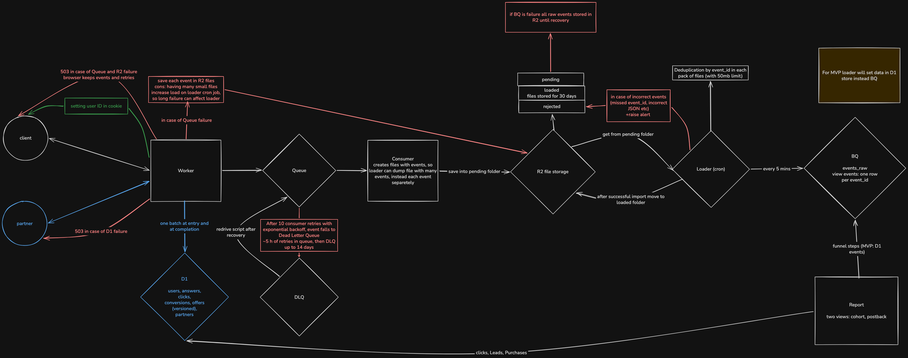

# Design: funnel analytics on Cloudflare and BigQuery

This is the Part 1 design of the system in `requirements.pdf`: prelanders with a three-step quiz, offer selection by fixed rules, partner postbacks, and funnel analytics in BigQuery. The reasoning behind each decision is in the ADRs ([index](../adr/README.md)), the tables and events are in [data-model.md](data-model.md), and metrics, alerts and cost are in [metrics-and-operations.md](metrics-and-operations.md). Every number has its source and arithmetic in [nfr.md](../requirements/nfr.md).

Sections 1 to 8 follow the topics of DES-2 in order; 9 to 11 cover extensions, change and the implementation plan.

Five things the spec leaves open, and where they are answered:

| Question | Short answer | Where |
|---|---|---|
| A returning user without a Lead has already answered steps 1 and 2. Quiz or redirect? | The quiz again, empty. Q-1 asks the company to confirm. | [Section 1](#1-questions-and-assumptions), [ADR 0004](../adr/0004-offer-selection-semantics.md) |
| A postback arrives before the click is stored, or for a click we never made | The click is stored before the 302, so a real click is always found. An unknown click goes to `quarantine` with `202` and an alert. | [Section 6](#6-postback-and-personal-data-security) |
| An offer is disabled after selection, or after a Lead | `/go` re-reads the status and selects again. At entry, rule 3 applies. | [Section 2](#2-architecture-and-alternatives) |
| Two tabs, the back button, a retried request | The completion request received last wins. EventIDs and postback keys stop double counting. | [Section 5](#5-retries-concurrent-changes-and-event-order) |
| BigQuery is down for hours | Files wait in R2 with no limit. Other failures and their limits are in a table. | [Section 7](#7-delivery-to-bigquery) |

## 1. Questions and assumptions

These seven questions shape the design the most. Each has a default, and the MVP implements the default, so no answer blocks the work. An answer that differs from a default changes the ADR named next to it.

| ID | Question | Default the MVP implements |
|---|---|---|
| Q-1 | A returning user without a Lead has already answered steps 1 and 2. Show the quiz again or redirect at once? If the quiz is shown, should it be prefilled? | Show the quiz again, empty ([ADR 0004](../adr/0004-offer-selection-semantics.md)). Prefilling would change only the page. |
| Q-2 | Where are users and partners? Are there data residency requirements (GDPR)? | Mostly EU and US traffic. Operational data (D1) is kept in the EU. |
| Q-3 | How many prelanders are there, on which domains, and are all served through Cloudflare? | Several prelanders under one registrable domain, told apart by the prelander ID in the path. |
| Q-6 | What can a partner send in a postback: method, signature, transaction ID, payout and currency, retry policy, the parameter that carries our click ID? | Our contract: a signed JSON POST with HMAC-SHA256 over the timestamp and body, a transaction ID and an optional payout ([ADR 0007](../adr/0007-postback-contract-and-auth.md)). No GET or unsigned mode. |
| Q-16 | How long are the email and raw events kept? Does anyone need the email in clear text (CRM, mailings)? | The email is encrypted in storage and never reaches BigQuery. Users without a Lead or Purchase are deleted after 90 days of inactivity. Retention of raw events is to be agreed. |
| Q-17 | Whose Cloudflare account hosts the MVP, and what monthly spend is acceptable? Is Workers Paid ($5 a month) fine? | Arthur's own account on Workers Paid at $5 a month, with spend reported in the README. |
| Q-29 | Does a Lead from one prelander apply on another prelander of the same domain? | Yes. The spec states the Lead rule per user, so a Lead redirects on every prelander of the domain. |

On Q-1: rule 3 says a user whose Lead offer is disabled gets normal selection and sees the quiz only if the answers are not sufficient. It can also be read as "sufficient answers always skip the quiz", for every user. We read it narrowly: skipping the prelander is for users already registered with a partner, as the business context puts it, and a user who did not convert gets the prelander again. If the company reads it the other way, one step of the selection function changes, and returning users with sufficient answers drop out of "started the quiz".

The other open questions, each with its default, are in [open-questions.md](../requirements/open-questions.md). So are assumptions A-1 to A-7: nine events per visit (18M a month, 6.9/s), every offer but 007 specialised, rule facts visible in seconds, the redirect as a 302 to a `.example` URL, the quiz inside the prelander, a 5% to 20% Lead rate.

## 2. Architecture and alternatives

The diagram reads in four paths. The live path runs from the browser to the Worker, which reads and writes the facts in D1 in one batch and answers with a page, an offer or a redirect. The event path runs from the Worker to a Queue, then to a consumer that writes files into R2 `pending/`, then to a loader cron that loads them into BigQuery every 5 minutes; in the MVP the same loader writes into a separate D1 events database instead. The postback path runs from the partner to the Worker and into D1. The report reads clicks, Leads and Purchases from the D1 facts, and funnel steps from the D1 events database in the MVP or from BigQuery in production. The requests of the demo scenario, in order, are in [request-flow.md](request-flow.md).

One Worker serves every endpoint:

| Endpoint | What it does | Facts in D1 | Events |
|---|---|---|---|
| `GET /p/{prelander}` | Sets the identity cookie, runs selection at entry, renders the quiz or answers `302` (Lead return, rule 3 skip) | reads in one batch; writes a click only when it redirects | `prelander_viewed`; on a redirect also `offer_selected`, `offer_click`; on the no-offer page also `offer_selected` (`no_offer`) |
| `POST /api/events` | Takes one browser event, sends it to the Queue, answers `202` | none | the event |
| `POST /api/complete` | Takes the answers and the email at the end of the quiz, runs selection, returns the offer | writes `users`, `user_answers`; reads Leads and the catalog | `quiz_completed`, `offer_selected` |
| `GET /go?prelander=&visit=` | Runs selection again for the cookie's user, stores the click, answers `302` with `click_id` | reads in one batch; writes `clicks` | `offer_click` |
| `POST /postback/v1/{partner}` | Checks the HMAC signature, finds the click, records the Lead or Purchase | writes `conversions` or `quarantine` | `lead`, `purchase` |
| `GET /api/report?view=cohort\|postback`, page `/report` | The funnel report in two views, as JSON and as a page | reads clicks and conversions | none |
| `GET /__probe` | Synthetic latency probe: the entry D1 batch for a user with no rows | reads only | none |

The facts the rules read sit in one D1 database ([ADR 0003](../adr/0003-operational-store.md)), written synchronously, so a Lead accepted a second ago is seen by the next entry. Events go past it: they feed analytics only, and the rules never read them (P-1). Selection is one pure function, `select(facts, catalog, moment)`, called at entry, at completion and at the redirect ([ADR 0004](../adr/0004-offer-selection-semantics.md)). Its decision table in [offer-selection.md](../requirements/offer-selection.md) is the unit test fixture. Operations add Workers Analytics Engine for latency and freshness data points, an alert cron every 5 minutes, and an external probe from the EU and the US.

### Where offer status is checked again

Offer status lives in the versioned catalog. A change, such as turning an offer off, writes a new full catalog version in one transaction through a script, with no deploy. Status is read from the current version at entry, at completion and at `GET /go`. The link names no offer, and `/go` runs selection on every press, so any catalog change made since the page was shown applies: an offer disabled in between is never sent to, and the press goes to the new result or shows the no-offer message (R-9). If it was disabled between a Lead and the return visit, the Lead gives no redirect: entry applies rule 3, which skips the quiz only when the answers are sufficient and then picks by rule 2 (OFF-9). A postback for a disabled offer is still counted, because the registration happened (Q-24).

### Alternatives

| Decision | Chosen | Set aside, and where it breaks | ADR |
|---|---|---|---|
| User identity | Server-set first-party cookie with a random UserID | localStorage ID: the server cannot see it before the page renders. Email: the spec forbids it. Fingerprinting: false merges. | [0002](../adr/0002-user-identity.md) |
| Store for rule facts | One D1 database, raw events kept out | D1 with events: event writes queue on the single writer in front of selection. Durable Object per user: a postback still needs a global click table. KV: 60-second visibility, no unique keys. External Postgres: one more provider and a round trip per request; it is the migration target. | [0003](../adr/0003-operational-store.md) |
| Selection semantics | Empty quiz without a Lead, most recent Lead wins, selection at entry, completion and redirect | Redirect everyone with sufficient answers: the returning cohort never sees the prelander. Highest-EPU Lead: can send a user to an account they left. First Lead: ignores later registrations. | [0004](../adr/0004-offer-selection-semantics.md) |
| Event ingestion | One event per request into a Queue; a consumer writes NDJSON files to R2 | Worker writes D1: a round trip per event and a 10 GB limit. Pipelines: behaviour during an outage is not documented. Durable Object buffer: rebuilds what Queues already does. | [0005](../adr/0005-event-ingestion-and-buffering.md) |
| BigQuery delivery | Load jobs every 5 minutes, a deduplicating view, `payload` as JSON | Streaming inserts: best-effort deduplication and no file to reload from. Storage Write API: a gRPC stream from a Worker is unverified. | [0006](../adr/0006-bigquery-delivery.md) |
| Postback authentication | HMAC-SHA256 over timestamp and body, POST only | Bearer token: the secret travels and a request can be replayed. IP allowlist: shared cloud IPs, body not protected. GET with a token: the token lands in logs. | [0007](../adr/0007-postback-contract-and-auth.md) |

## 3. Data model

There are two kinds of data. Facts are what the rules read on the live path; they are in D1 and written in the request. Events are the analytics record; they travel through the Queue and R2 into BigQuery.

| Table (D1 facts) | Holds | Key that matters |
|---|---|---|
| `users` | UserID, encrypted email, email hash, last completion time | `id`, the UserID |
| `user_answers` | the current answer per question, as JSON | `(user_id, question_key)`; only a newer `received_at` overwrites |
| `catalog_history`, `offers` | every catalog version as a full copy of all offers, with `partner_id`, EPU and status | `(version, id)` |
| `partners` | partner ID and its encrypted current and previous secret | `id` |
| `clicks` | every transition, with offer, catalog version, prelander, visit and reason | `click_id`, random, at least 128 bits |
| `conversions` | accepted Leads and Purchases | `UNIQUE (partner_id, type, transaction_id)` |
| `quarantine` | signed postbacks naming an unknown click | none; nothing here is counted |

A new user writes nothing to D1 until quiz completion, so a user who leaves before the email step has events and no rows. A daily job deletes users with no Lead and no Purchase after 90 days without activity, which keeps the facts database far from its 10 GB limit.

Every event has the same envelope: `event_id`, `schema_version`, `type`, `client_time`, `received_at`, `user_id`, `visit_id`, `seq`, `prelander_id` and `payload`. The Worker sets `user_id` from the cookie and `received_at` itself. A visit through the quiz to an offer emits nine events: `prelander_viewed`, three `step_viewed`, two `step_answered`, `quiz_completed`, `offer_selected` and `offer_click`. `lead` and `purchase` come from postbacks. `offer_selected` and `offer_click` carry the reason code and catalog version (P-3). [data-model.md](data-model.md) has the schemas, payloads and a trace of the demo.

## 4. User identification

The Worker gives each browser a random UserID in a first-party cookie: `HttpOnly`, `Secure`, `SameSite=Lax`, the registrable domain, 400 days, renewed on every page request ([ADR 0002](../adr/0002-user-identity.md)). The cookie arrives with the first request of a return visit, so the Worker can redirect a user with a Lead before the prelander renders (Q-21). The server takes the UserID from the cookie only and ignores any `user_id` in a request body. A cookie value that is not a UUID is replaced.

An EventID is created where the event is created: in the browser for browser events, kept across resends, and in the Worker for server events. Postbacks use their own key (section 5).

What identity does not do:

- No cross-device identity. A phone and a laptop are two users (Q-19).
- No merging by email. An email typed in the quiz confirms nothing (ID-3), and two browsers with the same email stay two users.
- An in-app browser (Instagram, TikTok) keeps its own cookies, so a user who taps "open in browser" arrives as a second user.
- Identity holds within one registrable domain. A prelander on another domain, cleared cookies or a private window give a new user (Q-3).

So "unique users" in every metric means unique browsers. If EU visitors must consent before the cookie is set (Q-27), a visitor who declines becomes a new user on every visit and gets no Lead return.

## 5. Retries, concurrent changes and event order

Answers reach D1 in one request, `POST /api/complete`, at the end of the quiz, together with the email. The body is the state of the final screen. The step events sent along the way are analytics history and never write D1. That settles most ordering problems:

| Case | What happens | Key or rule |
|---|---|---|
| Back button, changed answer | The completion body carries the final answers; every change is a new `step_answered` event with its own EventID | the step events are history (Q-4, QZ-4) |
| Two tabs complete the quiz | The completion request the server received last wins | `user_answers` upsert only when `received_at` is newer (R-10) |
| Completion request retried | The same values are written again; nothing changes | upsert |
| Browser resends an event, Queue redelivers one | Stored once | `event_id`, created in the browser and kept on resend (R-3, R-8) |
| Events arrive out of order | Analytics orders by `received_at`, then `seq` in a visit; D1 does not depend on event order | envelope |
| Partner redelivers a postback | Answered `200` `duplicate`, nothing written; the event is sent again with the same EventID | `UNIQUE (partner_id, type, transaction_id)` (R-4) |
| Second real Purchase | New `transaction_id`, so a new row, counted | same key (PB-5) |
| Second Lead for the same user and offer | Stored, counted once | one Lead per user per offer (Q-23) |
| Several Leads on active offers | The Lead we accepted last wins, then higher EPU, then lower offer ID | `conversions.accepted_at` (Q-10) |

A retried completion emits `quiz_completed` and `offer_selected` again with new EventIDs; metrics count distinct users, so no number moves. The full list is in [data-model.md, Idempotency and ordering](data-model.md#idempotency-and-ordering).

## 6. Postback and personal data security

A partner calls `POST /postback/v1/{partner}` with a JSON body: `type`, `click_id`, `transaction_id`, `occurred_at`, and optionally `payout`, `currency` and `partner_user_id` ([ADR 0007](../adr/0007-postback-contract-and-auth.md)). The signature is HMAC-SHA256 over the timestamp and the raw body, checked before parsing and compared in constant time. A timestamp more than 5 minutes from our clock is rejected; inside the window a replay is caught by the deduplication key. Each partner has its own secret, stored in `partners` encrypted with AES-GCM under a master key held in a Worker secret, so a database export holds only ciphertext. Rotation keeps a current and a previous secret, and both are accepted until the partner confirms the switch. A new partner is one row. Request logs do not record bodies or signatures.

The endpoint answers `401` for an unknown partner, a bad signature or a stale timestamp; `400` for a malformed body or a click that belongs to another partner's offer (Q-24); `200` `duplicate` for a redelivery; `503` when D1 or the Queue fails, so the partner retries. The rejected answers change no data (PB-8). If the Queue fails, the conversion row is already written; the partner's retry is answered `200` `duplicate` and the event is sent again under the same EventID.

A postback before its click cannot happen for a real click: `/go` and the entry redirect write the click row before they send the `302` (R-6). A correctly signed postback for a click we do not have, whether removed by the 90-day cleanup, sent by a broken integration or forged, is stored in `quarantine` with its raw body. It is answered `202`, so the partner stops retrying, it is not counted, and an alert fires on any new row (Q-11). It is never matched to a user by anything other than the click ID.

Personal data (P-5, R-12):

- The email exists only in the body of `POST /api/complete` and then in `users.email_enc` (AES-GCM) and `users.email_hash` (HMAC-SHA256 under a separate key, used for deletion requests, never to merge users).
- The event envelope has no field for an email, so events cannot carry it by construction. The step 3 answer is not an event; it goes only in the completion request.
- The email never appears in URLs, logs, error messages, the Queue, R2, BigQuery, partner URLs, the report or localStorage. A log-scanning test runs the demo with `u1@example.com` and asserts the address is absent everywhere (P-11).
- The UserID never leaves the system either; partners get the random click ID (P-2).

## 7. Delivery to BigQuery

The browser sends one event per request ([ADR 0005](../adr/0005-event-ingestion-and-buffering.md)). The Worker validates it and puts it on a Queue. A consumer writes batches of up to 100 events as newline-delimited JSON files to R2 `pending/`. A loader cron runs every 5 minutes, groups the files into batches of at most 50 MB, and starts a BigQuery load job ([ADR 0006](../adr/0006-bigquery-delivery.md)). A loaded batch moves to `loaded/`, kept 30 days; a batch that fails five load jobs, or a row that fails validation, goes to `rejected/` with an alert. Load jobs are free, and the files double as the backfill source.

Duplicates are removed in three layers: the job ID is derived from the batch, so a retried job cannot load twice; the loader drops repeated EventIDs inside a batch; and reports read a view that keeps one row per EventID. `events_raw` is partitioned by day and has `payload` as a JSON column, so a new payload field needs no table change.

Freshness is up to 30 seconds in the consumer, up to 5 minutes to the next loader run, plus the job, against the 15-minute target (NFR-3), with an alert at 15 minutes. In the MVP there is no BigQuery (MVP-4): the same loader runs every minute and inserts into the `events` table of a separate D1 database, keyed by `event_id`.

What happens when a part is down ([nfr.md, Derived](../requirements/nfr.md#derived)):

| What is down | What holds the events | At 6.9 events/s | At 200 events/s, sustained |
|---|---|---|---|
| BigQuery or the loader | files in R2 `pending/` | no limit except storage cost and Q-16 | no limit except storage cost and Q-16 |
| Consumer or R2 | the Queue retries for about 5 hours, then the dead letter queue holds 14 days or 25 GB, redriven by a script | 14 days, about 8.4M events | about 35 hours, about 25M events |
| Queue | the Worker writes each event as its own file to R2 `pending/` | as long as R2 is up; the loader drains about 30 events/s | as long as R2 is up |
| Queue and R2 together | the browser, which keeps unsent events and resends them | until the browser gives up | until the browser gives up |

So a BigQuery outage of hours or days loses nothing: the quiz never waits for BigQuery (NFR-4), files pile up in `pending/`, an alert fires when the oldest is an hour old, and the loader catches up afterwards. The spec's peak, 60,000 events in 5 minutes, is 0.2% of the Queue backlog. Events are lost only if the Queue and R2 are both down for longer than a browser keeps them.

## 8. Metrics, monitoring, costs and limits

Definitions and arithmetic are in [metrics-and-operations.md](metrics-and-operations.md) and [nfr.md](../requirements/nfr.md).

| Topic | Summary | Source |
|---|---|---|
| Metrics | 29 metrics, M-1 to M-29, each with a denominator, grain and repeat-visit rule. Funnel metrics count distinct users per prelander and UTC day; "started the quiz" is `step_viewed` for step 1 | [Metric definitions](metrics-and-operations.md#metric-definitions) |
| Late postbacks | Two report views: cohort by click date with an "as of" time, which grows as postbacks arrive, and postback by acceptance date, which never changes once a period ends | [Two report views](metrics-and-operations.md#two-report-views) |
| Latency | Server-side p95 over 15 minutes: 50 ms for `/api/events`, 300 ms for entry, completion, `/go` and postbacks; an EU and US probe at 500 ms end to end | [Latency target](metrics-and-operations.md#latency-target-nfr-6), [nfr.md](../requirements/nfr.md#set-in-stage-4) |
| Alerts | 12 alerts, from `freshness_lag` and `pending_oldest_file` to `quarantine_new_row` and the D1 size triggers, each with a threshold and an action | [Alerts](metrics-and-operations.md#alerts) |
| Cost | About $29 to $31 a month at 18M events on Workers Paid; Queues is $21.20 of it. BigQuery storage adds about $0.41 a month per month of history | [Cost](metrics-and-operations.md#cost-at-the-design-load), [nfr.md](../requirements/nfr.md#set-in-stage-4) |
| MVP storage | The MVP events database fills one 10 GB D1 database in about a month at the design load; `d1_events_size` fires at 7 GB. The facts database reaches its 7 GB trigger in 20 months or more | [MVP storage limits](metrics-and-operations.md#mvp-storage-limits-mvp-5) |

Latency is measured in the Worker, written to Analytics Engine and split by country (Q-2 puts D1 in the EU). When the MVP events database nears its limit, the loader is pointed at BigQuery, the last 30 days of `loaded/` files are reloaded, and older history is exported once. Users, answers, clicks, conversions and the catalog stay in D1, because Leads and offer status are read on every entry and cannot wait for a 15-minute pipeline. The migration path for the facts database, first several D1 databases split by UserID and then Postgres, is in [ADR 0003](../adr/0003-operational-store.md#migration).

The system is built to need little attention: three cron jobs, alerts sent by email or webhook at most once an hour each, Dependabot with the full test suite as the merge gate, and a monthly check of five items.

## 9. Future extensions

Both are designed and not built ([Extensions](metrics-and-operations.md#extensions)).

Offer exclusion after Purchase (DES-5, Q-20). A flag `offers.exclude_after_purchase` is set per offer in the catalog, so it is a data change. Step 1 of `select()`, empty today, marks a flagged offer the user has a Purchase for as inactive for that user. From there the existing rules treat it like a disabled offer: its Lead gives no redirect, rule 3 applies, and rule 2 never picks it. The work is one migration, the catalog script option, one filter and five new decision table rows.

EPU from real data (DES-6). The postback already carries `payout` and `currency`. A daily job computes revenue per unique user per offer over a trailing 30-day window by click date, ending behind today by the typical postback delay, into `offer_epu_observed`. Selection keeps reading EPU from the versioned catalog; once a week a script writes a new catalog version with the observed figure for offers with at least 500 users in the window. `select()` does not change.

## 10. How the system changes

Each likely change has one place to change and one check:

| Change | Place to change | Check to run |
|---|---|---|
| A fourth quiz question | A new step in the prelander's quiz flow config (one JSON file per prelander: steps with their question key, allowed values, wording and next step). The page renders from it, so no page code changes. No migration: `user_answers` is keyed by question. If the answer affects selection, also `select()` and its decision table | Completion test with the new key; the full test suite in CI, decision table included |
| A new offer | The catalog script writes a new catalog version with the offer. No deploy | Rows for the offer in the decision table; after the script, `offer_selected` carries the new `catalog_version` |
| A new partner | One `partners` row with its encrypted secret; its offers carry its `partner_id`. No deploy | A signed test postback through the helper gets `202`; an unsigned one gets `401` |
| A new prelander | Its config and its page. No schema change: every event and click carries `prelander_id` | Demo script on the new prelander; the report shows its row |
| A new event type | Sent from the client with a `schema_version`. The Worker and loader already pass unknown types and versions; `payload` is JSON in BigQuery | Tests `unknown schema_version is stored and not dropped` and `new payload field reaches BigQuery without a schema change` |
| A change in the selection rules | `select()`, one pure function, and nothing else ([ADR 0004](../adr/0004-offer-selection-semantics.md), "Shape of the selection code") | New decision table rows in [offer-selection.md](../requirements/offer-selection.md) first, then the unit tests; the OFF-12 rows must still pass |

Versioning:

- The catalog version is recorded on every click and every `offer_selected` event, so a redirect from last month is explained by the catalog it used.
- Every event carries `schema_version`; an unknown version is stored and passed on, never dropped.
- The postback contract version is in the path, `/postback/v1/`, so a partner on v1 keeps working when v2 appears.

Migrations are numbered, additive SQL files in the repository (new tables, nullable columns, indexes), applied by `wrangler d1 migrations apply` in CI before the deploy. Nothing is renamed or dropped in place.

Left out, and why:

- Durable Objects: a postback still needs a global click table, and a buffer would rebuild Queues ([ADR 0003](../adr/0003-operational-store.md), [ADR 0005](../adr/0005-event-ingestion-and-buffering.md)).
- KV: 60-second visibility and no unique keys ([ADR 0003](../adr/0003-operational-store.md)).
- Pipelines: no documented behaviour during an outage, so NFR-5 has no numbers; a candidate once that is documented ([ADR 0005](../adr/0005-event-ingestion-and-buffering.md)).
- External Postgres: one more provider and a round trip per request, kept as the migration target ([ADR 0003](../adr/0003-operational-store.md)).
- Fingerprinting: false merges and the same consent as a cookie ([ADR 0002](../adr/0002-user-identity.md)).
- GET postbacks: the token ends up in logs ([ADR 0007](../adr/0007-postback-contract-and-auth.md)).
- Cross-device identity: the deterministic routes need a partner user ID or a confirmed email, and the spec provides neither ([ADR 0002](../adr/0002-user-identity.md), Q-19).

## 11. Implementation plan and end-to-end slice

The Part 2 stages, each with the check that proves it, are in [part2-mvp-stages.md](../plans/part2-mvp-stages.md). It starts with the end-to-end slice: one prelander, the three-step quiz, `POST /api/complete` with selection, the `/go` redirect, a signed Lead postback, the Lead return at entry, and the report showing the counts, deployed on Cloudflare. Every requirement has an acceptance card in [acceptance-checks.md](../testing/acceptance-checks.md), run when that requirement is built.
