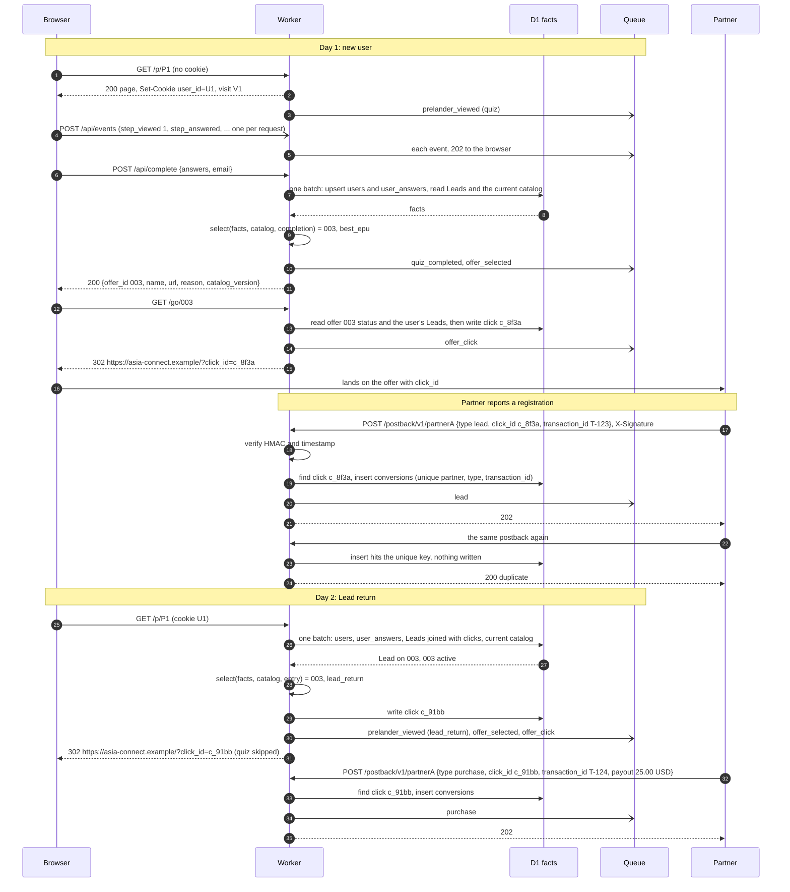

# Request flow

The demo scenario as a sequence of requests: a new user on day 1, a Lead from the partner, the same user returning on day 2, a Purchase. The components are the ones on [architecture.png](architecture.png); the tables and events each step touches are traced in [data-model.md, Trace of the demo](data-model.md#trace-of-the-demo). Email and IDs are synthetic.

Solid arrows are synchronous; open arrows (`-)`) are fire-and-forget sends to the Queue, from where events go to R2 and BigQuery without the browser or the partner waiting. The step events in step 4 never touch D1; the answers reach D1 only in step 6. Every write to `clicks` happens before the `302` that carries the click ID (R-6). The report after step 24 shows one Lead and one Purchase on offer 003 for prelander P1.
